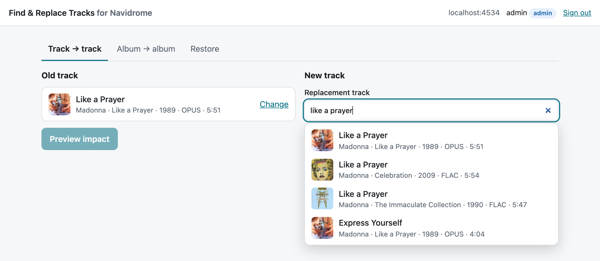
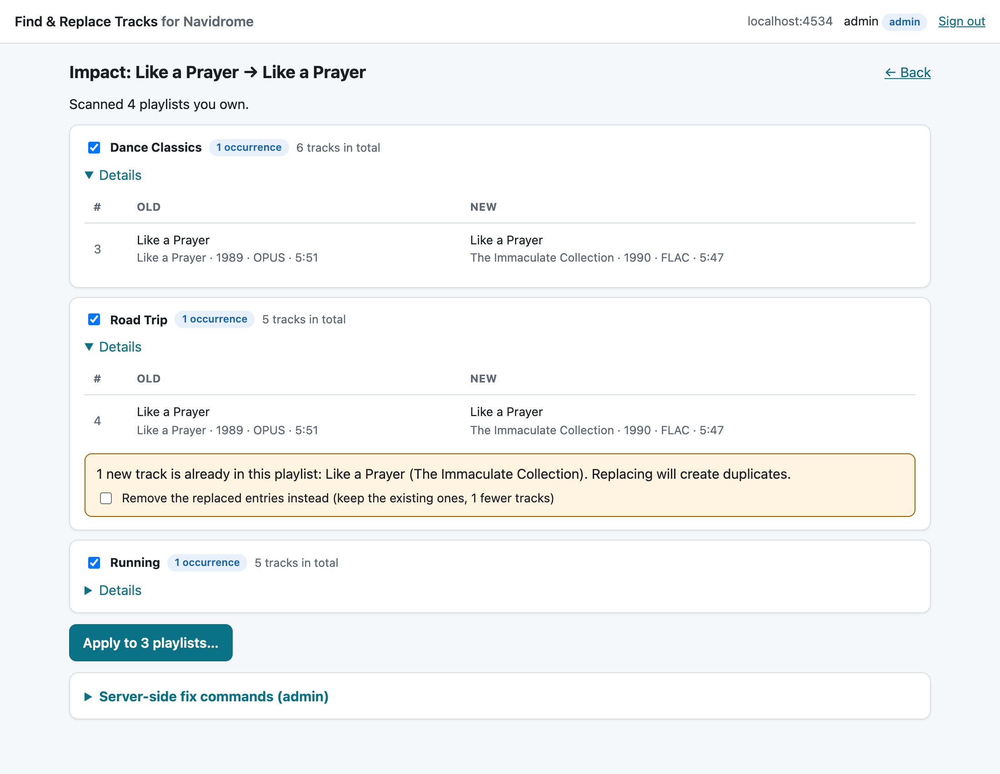

<h1 align="center">Find &amp; Replace Tracks</h1>
<p align="center"><em>for Navidrome</em></p>
<h3 align="center">Swap a track, or a whole album, for another release in all your Navidrome playlists, right from your browser.</h3>

<p align="center">
  
  
</p>

<p align="center">
  <a href="https://lehenandmartin.github.io/navidrome-find-replace/"><strong>Open Find &amp; Replace Tracks</strong></a> — runs in your browser, nothing to install
</p>

---

When you replace an album with another release (a remaster, another edition…), Navidrome gives the new files new track ids, and your playlists keep pointing at the old ones. This tool finds every playlist that uses the old tracks and swaps them for the new ones, in place, after showing you exactly what will change. Do it **before purging missing files** in Navidrome: purging removes the old entries from your playlists.

Everything happens in your browser: the page talks directly to your Navidrome server. There is no backend, no analytics, nothing loaded from a CDN. Your password is never stored, and the session ends when you sign out or close the tab.





## Features

- Track → track, or album → album with automatic track pairing (disc and track number, checked against the title) and manual corrections
- For administrators, albums with missing files are listed on arrival, with the most likely replacement already found
- Replacements spread over several albums are found track by track (a compilation replaced by the studio albums, or the other way round), preferring studio versions and avoiding live ones
- Preview of every affected playlist, with duplicate detection
- Exact order kept, result verified, backup to download, undo
- Only touches your own playlists; smart playlists are never modified
- English and French, light and dark themes, works on mobile

## Server requirements

- Navidrome served over **HTTPS**: browsers block requests from this HTTPS page to an `http://` server.
- If Navidrome is behind a reverse proxy, it must keep Navidrome's CORS headers and let `/auth`, `/api` and `/rest` through.
- Tested with Navidrome 0.64.2.

## Development

```bash
npm install
npm test
npm run dev
```

`docker compose up -d` starts a local Navidrome with generated test music; `node dev/dev.mjs seed`, then `node dev/dev.mjs replace`, set up playlists and simulate a replaced album.

## About

This project was built with the assistance of [Claude](https://claude.ai), under the author's direction and review.

## License

[MIT](LICENSE) — © 2026 Martin Le Hénand
